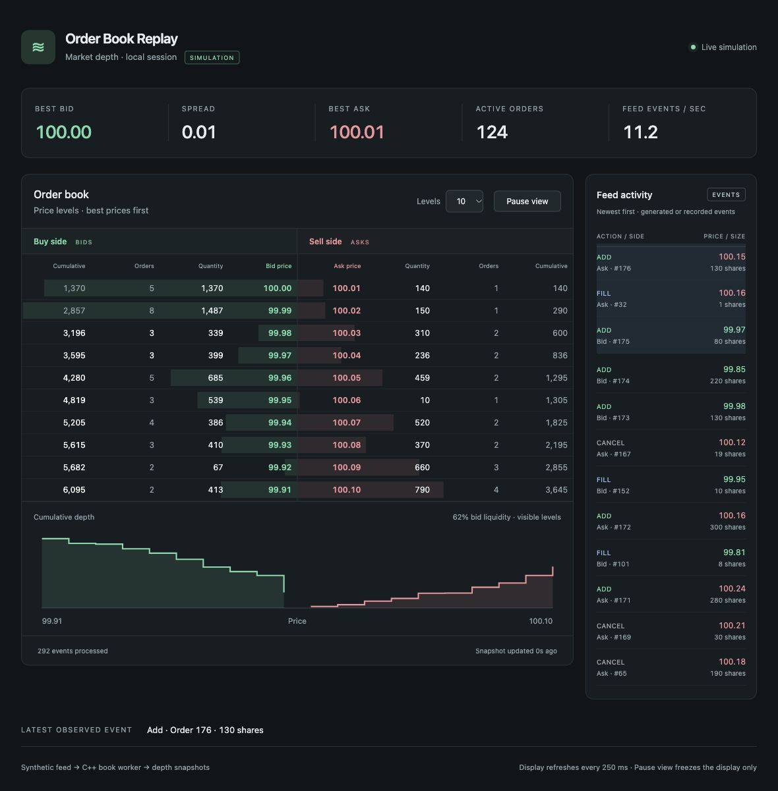

# Order Book Replay

C++20 order-book reconstruction from CSV or synthetic events, with a market-depth dashboard.

My college senior project used Nasdaq TotalView-ITCH data to study short-sale regulation. This project revisits order books and refreshes my modern C++ skills after a few years away from it.



## Run

Dependencies: C++20, CMake 3.16+, Bash, Python 3.

```sh
./run-demo.sh [port]  # synthetic feed + dashboard; default port 8000
```

CSV replay:

```sh
cmake -S . -B build && cmake --build build
./build/order_book_replay examples/demo.csv
```

Dashboard output: add `--snapshot frontend/state.json --delay-ms 100` and serve `frontend/` with `python3 -m http.server 8000 --bind 127.0.0.1 --directory frontend`.

CSV input uses the layout in `examples/demo.csv`: one instrument, numeric timestamps and prices, price scale 1e9.

## Design

- Producer/consumer threads connected by a mutex-protected queue
- Order-ID lookup via `unordered_map`; sorted bid/ask levels via `std::map`
- Add, cancel and fill events; quantities aggregated by price
- JSON snapshots consumed by the dashboard every 250 ms

Fills come from the feed; no matching logic. Modify/clear events are ignored, and cancels remove whole orders. The synthetic feed can leave best prices unchanged for long stretches.

I used AI assistance for the frontend and parts of the C++ implementation.

## TODO

- [ ] Improve synthetic quote movement
- [ ] Add parsing and worker-thread error handling
- [ ] Bound the queue and add backpressure
- [ ] Support modify, clear and partial cancellations
- [ ] Add a Linux TCP feed using nonblocking sockets and `epoll`
